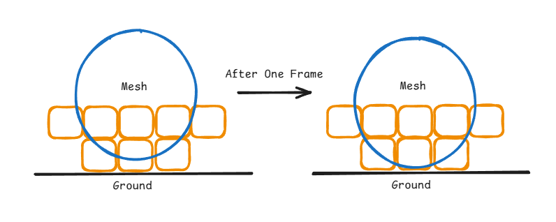
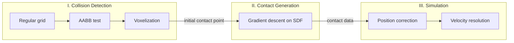
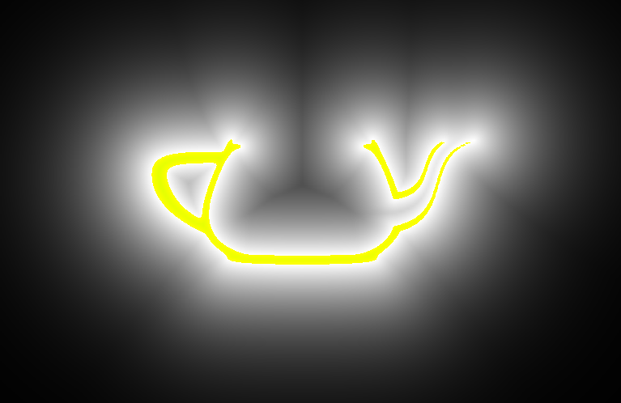
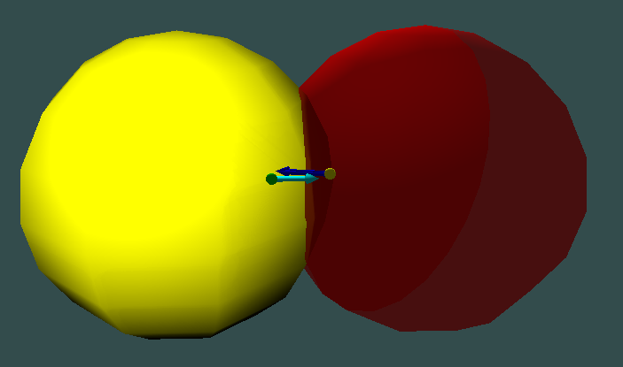
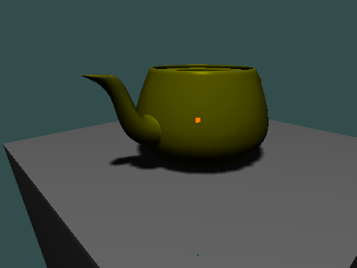
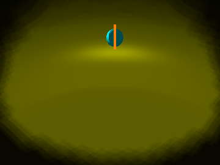
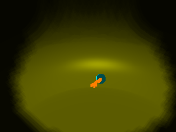
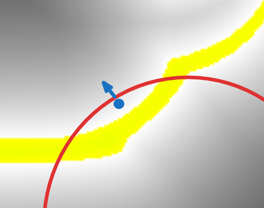

# 基於體素的剛體碰撞檢測

Voxel-based rigid body collision detection：以 voxelization 做粗略的 collision detection，再於 Signed Distance Field（SDF）上以 gradient descent 求出精確的 contact data（penetration depth、contact point、contact normal），改善體素法造成的接觸抖動。以 OpenGL compute shader 實作、GPU 加速。

> 國立臺灣海洋大學 資訊工程學系 專題研究｜陳宏勝｜指導教授：翁世光

## 動機

在遊戲引擎課的作業中，我起初以 voxelization 處理 contact generation，物體接觸時卻劇烈抖動。原因是物體在不同位置可能佔據完全相同的 voxel（下圖，橘色為 voxel、藍色為 mesh），由 voxel 中心算出的 penetration depth 帶有 O(h) 的誤差（h 為 voxel 邊長）：position correction 後物體看似脫離碰撞，下一個 frame 卻再度下墜，反覆形成抖動。單純把 voxel 切小，記憶體會隨解析度的三次方成長（目前每個物體 256³ 已需約 2 MB），並不可行。因此我改以 SDF 表示幾何，參考 [3] 在 SDF 上以 gradient descent 求得更精確的 contact data，voxelization 則保留作為粗略的碰撞檢測與初始點的來源。

## 方法

- **Voxelization 與 collision detection**：物體皆為 watertight triangle mesh。採用 Schwarz 的 rasterization 方法 [2] 在 GPU 上 voxelize：每個 voxel 只佔 1 bit，沿 z 軸每 32 個打包成一個 unsigned int 存入 3D texture。先以 regular grid 與 AABB test 排除不可能碰撞的物體對，其餘的物體對再於 compute shader 中比對兩物體相同位置的 voxel bit；重疊 voxel 的幾何中心作為下一階段的初始點 x0。
- **SDF 生成**：把 mesh 的 AABB 切成 256³ 的網格，計算每個網格中心到所有三角片的最短距離，並以 generalized winding number [4] 判斷內外，內部的距離記為負值；結果存入 3D texture，使用硬體的 trilinear interpolation。
- **Contact generation**：參考 [3]，從 x0 出發沿 −∇φB 深入物體 B，一旦離開物體 A 就投影回 A 的表面，最後得到 A 表面上最深入 B 的點 pa；na = ∇φB(pa) 即為 contact normal。
- **Simulation**：position correction 與 velocity resolution 參考 [1]。

## 成果

| SDF 切面（猶他茶壺，256³） | 兩球碰撞的 contact data |
|:-:|:-:|
|  |  |

左圖為 23,350 片三角片的猶他茶壺以 256³ 解析度生成的 SDF 切面（黃色為內部，距離越遠越暗），在 RTX 2060 上約需 45 秒。右圖青色箭頭為右側球的 contact normal，長度為 penetration depth；左側球的 contact point（黃點）準確地貼在其表面上。

茶壺平放在平台上經過數個 frame 後的質心軌跡：

| 場景 | Voxelization 方法 | SDF 方法 |
|:-:|:-:|:-:|
|  |  |  |

SDF 方法的抖動範圍明顯縮小，大部分肉眼可見的抖動已被消除；但因為目前一次只處理一個 contact point，物體會沿平行地板的方向產生些微位移。

## 限制與後續工作

- **薄壁**：物體穿入茶壺壁這類薄結構時，contact normal 可能指向錯誤的方向，反而把物體往壁內推（下圖，紅色圓為球，藍點與藍色箭頭為其 contact point 與 contact normal）。

  

- **高速穿透**（進行中）：把旋轉後的 voxel 視為 OBB，以 OBB vs OBB 的 continuous collision detection（CCD）處理物體高速移動時穿牆或穿過薄壁的問題。
- **多個 contact point**：把歷史 contact point 存在各物體的 local coordinate system 中，維持固定數量，讓方塊這類需要多點支撐的物體也能穩定站立。

## 開發環境

Windows、Visual Studio 2022（`cg_project.sln`）、OpenGL compute shader、Dear ImGui。SDF 生成程式與 [RaytracingDistanceField](https://github.com/asd7766zxc/RaytracingDistanceField) 共用。

## 參考文獻

1. I. Millington, *Game Physics Engine Development: How to Build a Robust Commercial-Grade Physics Engine for your Game*, 2nd ed. Morgan Kaufmann, 2010.
2. M. Schwarz, "Practical Binary Surface and Solid Voxelization with Direct3D 11," in *GPU Pro 3*, W. Engel, Ed. A K Peters, 2012, pp. 337–352.
3. P. Liu, Y. Zhang, H. Wang, M. K. Yip, E. S. Liu, and X. Jin, "Real-time Collision Detection between General SDFs," *Computer Aided Geometric Design*, vol. 111, Art. no. 102305, 2024.
4. A. Jacobson, L. Kavan, and O. Sorkine-Hornung, "Robust Inside-Outside Segmentation using Generalized Winding Numbers," *ACM Transactions on Graphics*, vol. 32, no. 4, 2013.
